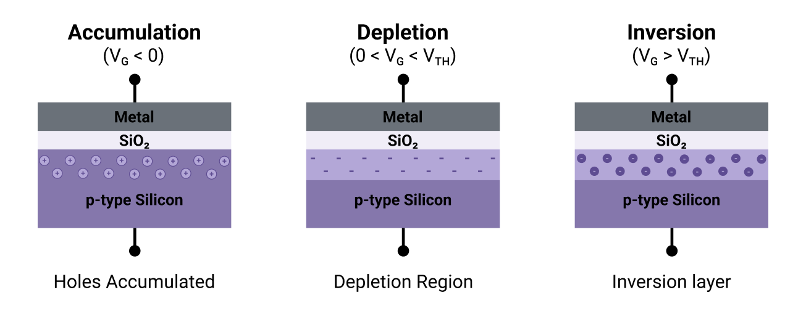

# MOS C-V Characterization

C-V characterization is one of the most useful techniques for studying **MOS (metal-oxide-semiconductor) structures.** By changing the voltage applied to the gate, we change the distribution of charge near the semiconductor-oxide interface. This produces the characteristic accumulation, depletion, and inversion regions of the C-V curve.

A basic MOS capacitor consists of a conductive gate separated from the semiconductor by a thin dielectric layer:

<figure><figcaption>
<strong>Schematic cross-section of a MOS capacitor</strong>
</figcaption></figure>

For an ideal MOS capacitor, the oxide capacitance is:

$$
C_{ox} = \frac{\epsilon_{ox}A}{t_{ox}}
$$

where $$A$$ is the gate area, $$t_{ox}$$ is the oxide thickness, and $$\epsilon_{ox}$$ is the permittivity of the oxide.

### Accumulation, depletion and inversion

<figure><figcaption>
<strong>Charge distribution in a MOS capacitor with a p-type substrate</strong>
</figcaption></figure>

Consider a MOS capacitor fabricated on a **p-type substrate.** As the gate voltage is changed, the charge distribution near the semiconductor surface changes.

#### Accumulation

When a negative voltage is applied to the gate, holes are attracted toward the semiconductor-oxide interface. The majority carriers accumulate close to the surface. In this region, the measured capacitance approaches the oxide capacitance:&#x20;

$$
C \approx C_{ox}
$$

#### Depletion

As the gate voltage becomes more positive, holes are repelled from the semiconductor surface. This creates a **depletion region** containing ionized acceptor atoms but few mobile carriers.\
\
The depletion region behaves like an additional capacitance:

$$
C_{dep} = \frac{\epsilon_s A}{W_d}
$$

where $$W_d$$ is the depletion width.\
\
The oxide and depletion capacitances effectively appear in series:

$$
\frac{1}{C} = \frac{1}{C_{ox}} + \frac{1}{C_{dep}}
$$

As the depletion region becomes wider, $$C_{dep}$$ decreases, causing the measured capacitance to decrease.

#### Inversion

With sufficiently positive gate voltage, the surface concentration of electrons becomes large enough to form an **inversion layer** near the semiconductor-oxide interface.

What happens to the measured capacitance in this region depends strongly on the feequency of the measurement signal.

### Low and high frequency C-V

The behavior of MOS capacitor in inversion depends strongly on the frequency of the AC measurement signal.

<figure><figcaption>
<strong>Schematic low- and high-frequency C-V characteristics of a MOS capacitor with a p-type substrate</strong>
</figcaption></figure>

At **low frequencies**, minority carries have enough time to respond to the changing AC signal. In a p-type substrate, electrons can move toward and away from the semiconductor surface as the AC voltage changes. As a result, the inversion layer contributes to the small-signal response and the measured capacitance increases again toward $$C_{ox}$$.

At **high frequencies**, minority carriers cannot respond quickly enough to the AC signal. The inversion charge therefore remains approximately constant during each AC cycle. Changes in the AC voltage mainly change the width of the depletion region.\
\
Once the depletion region reaches approximately its maximum width, the measured capacitance approaches a minimum value, $$C_{min}$$.\
\
The minimum capacitance is determined by the series combination of the oxide capacitance and the maximum depletion capacitance:

$$
\frac{1}{C_{min}} = \frac{1}{C_{ox}} + \frac{1}{C_{dep_{max}}}
$$

where:

$$
C_{dep_{max}} = \frac{\epsilon_s A}{W_{d_{maxs}}}
$$

### Parameter Extraction

A measured MOS C-V curve can be used to extract several physical and electrical parameters of the device.

#### Oxide Capacitance and Thickness

The oxide capacitance $$C_{ox}$$ can be estimated from the accumulation region, where the measured capacitance approaches the oxide capacitance.\
\
Once $$C_{ox}$$ is known, the oxide thickness can be estimated from:

$$
t_{ox} =
\frac{\epsilon_{ox}A}{C_{ox}}
$$

For silicon dioxide:

$$
\epsilon_{ox} = \epsilon_0 \epsilon_r
$$

with $$\epsilon_r \approx 3.9$$.\
\
This make C-V measurement a useful method for estimating the thickness of thin gate dielectrics.

#### Flat-Band Voltage

The **flat-band voltage** $$V_{FB}$$ is the gate voltage at which there is no band bending in the semiconductor.\
\
For an ideal MOS structure, it is determined by the work-function difference between the gate and semiconductor. In a real device, oxide and interface charges can shift the flat-band voltage:

$$
V_{FB} = \phi_{ms} - \frac{Q_{ox}}{C_{ox}}
$$

where $$\phi_{ms}$$ is the gate-semiconductor work-function difference and $$Q_{ox}$$ represents the effective oxide charge.

The position of the measured C-V curve relative to the ideal characteristic can therefore provide information about charge present in the oxide or near the semiconductor-oxide interface.

#### Threshold Voltage

The **threshold voltage** $$V_{TH}$$ marks the transition into strong inversion.\
\
For a p-type substrate, the ideal MOS threshold voltage can be written approximately as:

$$
V_{TH} = V_{FB} + 2\phi_F +
\frac{\sqrt{4q\epsilon_s N_A\phi_F}}{C_{ox}/A}
$$

where $$N_A$$ is the acceptor concentration and $$\phi_F$$ is the Fermi potential, $$q$$ is the elementary charge, and $$\epsilon_s$$ is the semiconductor permittivity.

In practice, threshold voltage can be estimated from the measured C-V characteristic using the extracted device parameters.

#### Substrate Doping

The depletion region of the MOS capacitor depends on the doping concentration of the semiconductor. Because this depletion region contributes to the measured capacitance, the C-V curve can be used to estimate the substrate doping.

The depletion capacitance per unit area is:

$$
C_{dep} = \frac{\epsilon_s}{W_d}
$$

and the depletion width depends on the semiconductor doping concentration. This means that the shape of the C-V curve in depletion contains information about the doping of the substrate.

#### Interface Traps

Defects at the semiconductor-oxide interface can create electronic states known as **interface traps**.

These traps can exchange charge with the semiconductor and affect the measured C-V characteristic. Depending on their response time and the measurement frequency, they can stretch or distort the C-V curve and introduce frequency-dependent behaviour.

The density of interface traps, usually written as $$D_{it}$$, can be estimated using several C-V measurement techniques, including comparisons between measurements performed at different frequencies.

#### Non-ideal C-V Characteristics

Real MOS capacitors rarely produce an ideal C-V characteristic. Difference between the measured and ideal curves can provide useful information about the quality of the oxide and semiconductor-oxide interface.\
\
Common non-ideal effects include:

* **oxide charge**, which can shift the C-V curve along the voltage axis,
* **interface traps**, which can stretch or distort the transition between regions,
* **hysteresis**, where the measured curve depends on the direction of the voltage sweep,
* **frequency dispersion**, where the measured capacitance changes with measurement frequency,
* **leakage current**, which can affect the accuracy&#x20;
* **series resistance**, which can introduce measurement errors, particularly at higher frequencies.

Because of these effects, measurements at different frequencies and sweep directions can provide additional information about the MOS structure.

### References

* Robert F. Pierret, Semiconductor Device Fundamentals, Addison-Wesley, 1996, Chapter 16: “MOS Fundamentals,” Section 16.4: “Capacitance-Voltage Characteristics.”
